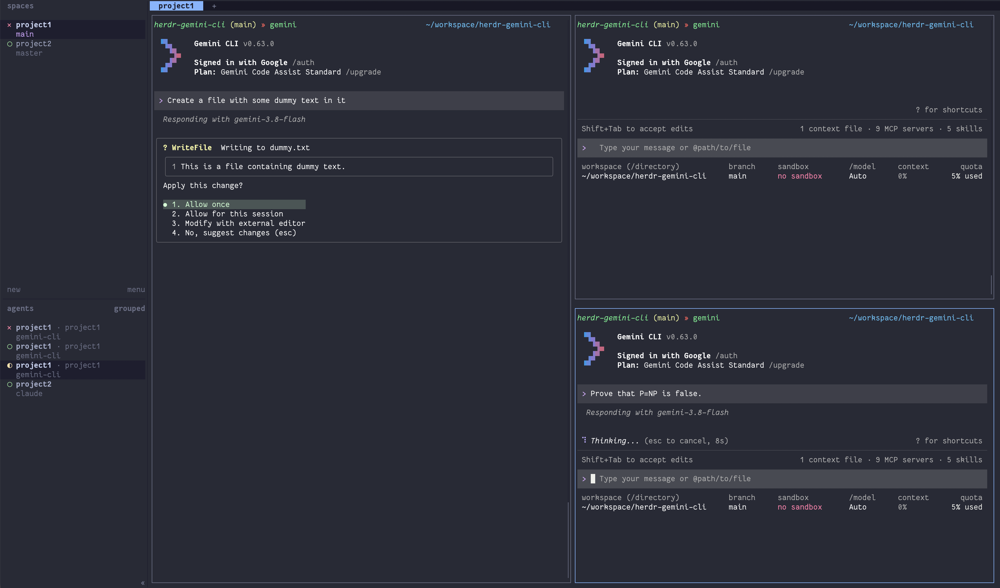

# herdr-gemini-cli

[](https://github.com/ahmerb/herdr-gemini-cli/actions/workflows/ci.yml)
[](https://opensource.org/licenses/MIT)


**Herdr integration for Google Gemini CLI.**

`herdr-gemini-cli` brings native, agent-aware multiplexing and session management to **[Gemini CLI](https://github.com/google-gemini/gemini-cli)** inside **[Herdr](https://herdr.dev)**. It enables real-time status tracking in Herdr's sidebar and status bar, automated session resumption on restart, and non-blocking notification alerts when Gemini CLI is waiting for user confirmation.


*Herdr sidebar tracking multiple Gemini CLI sessions across lifecycle states: `x` (blocked waiting for tool approval), `o` (idle), and `◐` (actively working).*

> [!NOTE]
> This project is human-supervised, test-covered, but ultimately vibe-coded. Use at your own risk.

---

## Features

- **One-Command Install:** `herdr plugin install ahmerb/herdr-gemini-cli` installs the Herdr plugin and the Gemini CLI extension together, and `herdr plugin update` keeps them in sync.
- **Authoritative State Tracking:** Accurately maps Gemini CLI's internal lifecycle hooks to Herdr states:
  - **`working`**: Emitted when a turn starts and the model or tool is active.
  - **`idle`**: Emitted when a turn finishes and the agent is ready for user input.
  - **`blocked`**: Emitted with tool details whenever Gemini CLI prompts for action confirmation (e.g. `run_shell_command`).
- **Native Session Resumption:** Automatically registers active conversation UUIDs with Herdr. When Herdr restores a workspace or restarts, panes automatically resume via `gemini --resume <session_id>`.
- **Automatic Pane Cleanup:** Explicitly releases pane ownership when Gemini CLI exits cleanly or clears.
- **Zero Runtime Dependencies:** Compiles into lightweight, zero-dependency CommonJS artifacts. Does not require `jq`, Python, or `node_modules` at runtime—it runs directly on the ambient Node.js instance powering Gemini CLI.
- **Dormant Outside Herdr:** Strictly guards execution using `HERDR_ENV=1`. Outside of Herdr, hooks execute dormancy checks and exit in under 5ms with zero side effects.
- **Built-in Diagnostic Doctor:** Ships with an interactive doctor CLI to verify Herdr socket connectivity, pane status, and reporting delivery.

---

## Installation

**Prerequisites:** [Herdr](https://herdr.dev) 0.9.5 or newer, [Gemini CLI](https://github.com/google-gemini/gemini-cli), Node.js 20+ and `git`. `gemini` and `node` must be on your `PATH`.

### Method 1: Install as a Herdr plugin (Recommended)

One command sets up everything. You don't need to clone anything:

```bash
herdr plugin install ahmerb/herdr-gemini-cli
```

What happens:

1. Herdr clones the repository into its own managed directory and shows a preview of the plugin, including its build step `sh plugin/install-extension.sh`. Confirm to continue.
2. The build step installs the Gemini CLI extension (the hooks that report pane state) at the exact commit Herdr checked out, using `gemini extensions install <repo url> --ref <commit> --consent --skip-settings`. Any existing `herdr-gemini-cli` Gemini extension is replaced. (Installing from Herdr's checkout folder directly would stop at Gemini's folder-trust prompt.) The step also records where it found `node` and `gemini`, so plugin actions still work when Herdr's own `PATH` lacks them (common with nvm or npm-global installs).
3. Herdr registers the plugin and its actions (see [Herdr plugin](#herdr-plugin)).

Restart any Gemini CLI sessions that were already running so they load the hooks.

Check that both halves are installed:

```bash
herdr plugin list            # herdr-gemini-cli is listed and enabled
gemini extensions list       # herdr-gemini-cli is listed
```

Update both together. This re-runs the build step, so the Gemini extension always matches the plugin version:

```bash
herdr plugin update herdr-gemini-cli
```

### Method 2: Gemini CLI extension only

If you only want state tracking and session resume, without the Herdr plugin actions:

```bash
gemini extensions install https://github.com/ahmerb/herdr-gemini-cli
```

### Method 3: Local development

```bash
git clone https://github.com/ahmerb/herdr-gemini-cli.git
cd herdr-gemini-cli
npm install
npm run build
herdr plugin link .          # register the plugin from this working tree
gemini extensions link .     # symlink the Gemini extension to this working tree
```

`herdr plugin link` does not run the build step, so link the Gemini extension yourself as shown. Unlink with `herdr plugin unlink herdr-gemini-cli` and `gemini extensions uninstall herdr-gemini-cli`.

### Uninstalling

`herdr plugin uninstall` only removes the Herdr plugin, so remove the Gemini extension first with the "Gemini: remove extension" action (see [Reinstall / remove Gemini extension](#reinstall--remove-gemini-extension)):

```bash
herdr plugin action invoke herdr-gemini-cli.remove-extension   # press Enter to close the popup
herdr plugin uninstall herdr-gemini-cli
```

If the plugin is already gone, remove the extension with Gemini directly: `gemini extensions uninstall herdr-gemini-cli`.

If the Gemini extension stays installed, it keeps reporting pane state whenever you run Gemini CLI inside Herdr. Outside Herdr it does nothing.

---

## Herdr plugin

The Herdr plugin adds Gemini actions to Herdr. Run an action with `herdr plugin action invoke <action id>`, or bind it to a key (see [Keybindings](#keybindings)). List them with:

```bash
herdr plugin action list --plugin herdr-gemini-cli
```

Plugin logs (output of each action run) are available via `herdr plugin log list --plugin herdr-gemini-cli`.

### Clear blocked state

Action id: `herdr-gemini-cli.clear-blocked` ("Gemini: clear blocked state").

Gemini CLI fires no hook when you deny or cancel a tool permission prompt, so Herdr keeps showing the pane as `blocked` until you submit the next prompt. Run this action with the stuck Gemini pane focused to set it back to `idle`:

```bash
herdr plugin action invoke herdr-gemini-cli.clear-blocked
```

or bind it to a key (suggested: `prefix+alt+u`, see [Keybindings](#keybindings)).

- It only acts on the focused pane, and only when that pane is a Gemini pane (`gemini-cli`) whose status is `blocked`. Otherwise it does nothing and says why in the plugin log.
- It reports as the same source and agent as the Gemini hooks, with a newer sequence number, and never releases the pane, so the pane's stored session and its `gemini --resume <id>` resume command are kept. The next Gemini hook (e.g. when you submit a prompt) takes over as usual.
- Herdr may show the cleared pane as `done` rather than `idle` until you look at it, as it does whenever an unfocused agent goes idle.

### New Gemini pane

**Gemini: new pane** (`herdr-gemini-cli.new-pane`) splits the focused pane to the right, in the same directory, focuses the new pane, and starts `gemini` in it:

```bash
herdr plugin action invoke herdr-gemini-cli.new-pane
```

The new pane is a normal shell pane with `gemini` typed into it, so the Gemini hooks and session resume work as usual, and exiting Gemini drops you back to the shell. If `gemini` can't be found, Herdr shows a notification and no pane is opened.

### Reinstall / remove Gemini extension

Manage the Gemini CLI extension (the hooks that report pane state) without reinstalling the plugin:

| Action id | Title | What it does |
| :--- | :--- | :--- |
| `herdr-gemini-cli.reinstall-extension` | Gemini: reinstall extension | Reinstalls the extension at the plugin's version, exactly like the install build step (`plugin/install-extension.sh`). Use it if the extension was removed, or Gemini CLI was installed after the plugin. |
| `herdr-gemini-cli.remove-extension` | Gemini: remove extension | Runs `gemini extensions uninstall herdr-gemini-cli`. Safe to run when it is not installed. Run it before `herdr plugin uninstall`, which can't remove the extension. |

```bash
herdr plugin action invoke herdr-gemini-cli.reinstall-extension
herdr plugin action invoke herdr-gemini-cli.remove-extension
```

Each action opens a popup that shows the output and stays open until you press Enter. Restart running Gemini CLI sessions afterwards so they load (or unload) the hooks.

If the extension is a development link (`gemini extensions link .`, listed with `Type: link`), reinstalling would replace the link with a copy, so the reinstall popup asks first and keeps the link unless you answer `y`. Remove deletes the link (your working tree is untouched).

If `gemini` isn't found, the popup says so. Install Gemini CLI, then run `herdr plugin update herdr-gemini-cli` (which records its location for plugin actions) or the reinstall action.

### Doctor

_Coming soon ([#9](https://github.com/ahmerb/herdr-gemini-cli/issues/9))._

### Session picker

_Coming soon ([#10](https://github.com/ahmerb/herdr-gemini-cli/issues/10))._

### Keybindings

Plugins can't register keybindings, so add them to your Herdr config (`~/.config/herdr/config.toml`) and run `herdr server reload-config`. Each binding is a `[[keys.command]]` entry with `type = "plugin_action"`:

```toml
[[keys.command]]
key = "prefix+alt+d"
type = "plugin_action"
command = "herdr-gemini-cli.doctor"
description = "Gemini: doctor"
```

Suggested bindings (none clash with Herdr's defaults or its example `prefix+alt+g` lazygit popup):

| Key | Action id | Action |
| :--- | :--- | :--- |
| `prefix+alt+u` | `herdr-gemini-cli.clear-blocked` | Clear blocked state |
| `prefix+alt+n` | `herdr-gemini-cli.new-pane` | New Gemini pane |
| `prefix+alt+d` | `herdr-gemini-cli.doctor` | Doctor _(coming soon)_ |
| `prefix+alt+r` | `herdr-gemini-cli.resume-session` | Session picker _(coming soon)_ |

---

## Diagnostics & Troubleshooting

Run the included doctor utility inside your terminal to validate environment detection and test reporting:

```bash
# If cloned locally:
./bin/herdr-gemini-cli.js

# Or via npm/npx:
npx herdr-gemini-cli
```

**Example Doctor Output (Inside Herdr):**

```text
=== Herdr Gemini CLI Integration Doctor ===

HERDR_ENV:          1
HERDR_PANE_ID:      wD:p1
HERDR_BIN_PATH:     /home/user/.local/bin/herdr
HERDR_SOCKET_PATH:   /home/user/.config/herdr/herdr.sock
Herdr Status:       ACTIVE (Running inside Herdr)

Herdr binary check:
  ✅ herdr 0.9.5

Testing agent report ping (state: idle)...
  Executing: /home/user/.local/bin/herdr pane report-agent wD:p1 --source gemini-cli --agent gemini-cli --state idle --seq 1794470669137000
  ✅ Test report delivered successfully to Herdr!

Doctor check completed.
```

---

## Architecture & Lifecycle Mapping

Herdr uses an in-band, push-based reporting architecture. Gemini CLI hooks trigger the dispatcher (`dist/hooks/dispatcher.js`), which translates internal events into Herdr CLI calls:

| Gemini CLI Lifecycle Event | Trigger Condition | Herdr Reported State | Additional Data |
| :--- | :--- | :--- | :--- |
| **`SessionStart`** | Startup, resume, or `/clear` | `idle` | Registers session UUID and resume command: `gemini --resume <session_id>` |
| **`BeforeAgent`** | User submits prompt; agent planning begins | `working` | Session ID |
| **`Notification`** | `ToolPermission` confirmation required | `blocked` | `--message "Waiting for approval to run <tool_name>"` |
| **`BeforeTool`** | User approves action; tool begins execution | `working` | Clears blocked state |
| **`AfterAgent`** | Model finishes turn; awaiting next prompt | `idle` | Session ID |
| **`SessionEnd`** | CLI exits (`/exit`, `Ctrl+D`, clear) | *(released)* | Executes `pane release-agent` |

> **Known limitation:** Gemini CLI fires no hook when a tool permission prompt is denied or cancelled, so the pane stays `blocked` until the next prompt is submitted. Run the [Clear blocked state](#clear-blocked-state) plugin action (`herdr-gemini-cli.clear-blocked`) to reset it to `idle` straight away.

### Sequence Numbering (`--seq`)

Herdr requires monotonically increasing sequence numbers to reject out-of-order or stale events. `herdr-gemini-cli` uses microsecond-resolution monotonic counters to guarantee strict ordering across asynchronous turns.

---

## Development

Prerequisites:
- Node.js >= 18.0.0
- npm >= 9.0.0

```bash
# Install development dependencies
npm install

# Run type checking
npm run typecheck

# Run test suite
npm test

# Build bundled artifacts
npm run build

# Validate extension schema with Gemini CLI
gemini extensions validate .
```

---

## Contributing

Contributions, bug reports, and suggestions are welcome! Please read [CONTRIBUTING.md](./CONTRIBUTING.md) for guidelines on code style, testing, and pull requests.

---

## License

This project is licensed under the [MIT License](./LICENSE).
